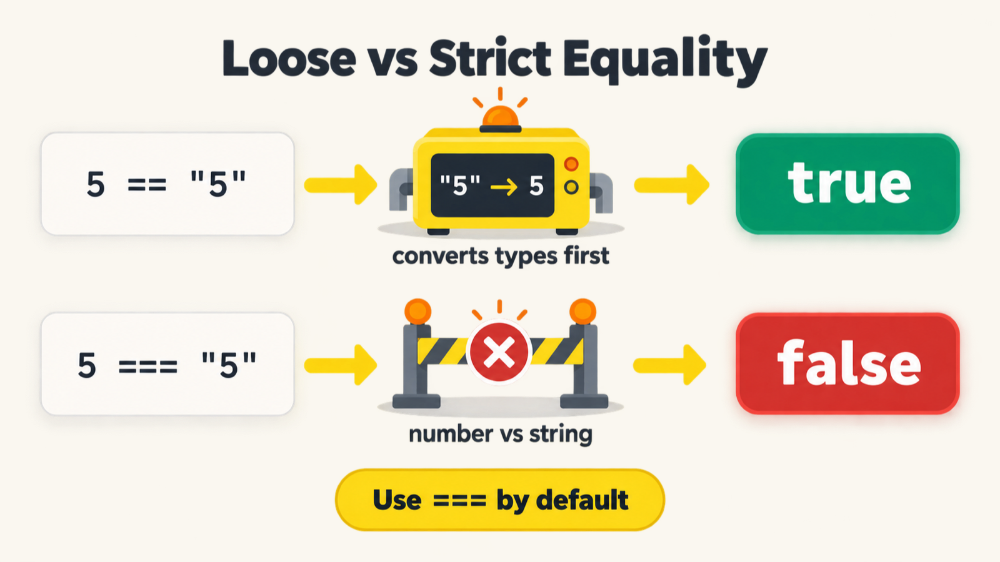
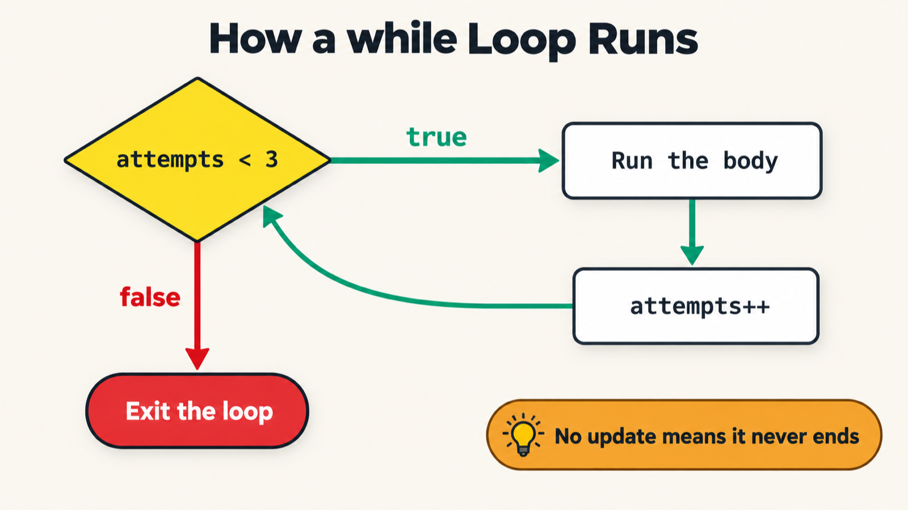

# LearnJSTSPlaywright4x

Practice code and notes from learning JavaScript, TypeScript and Playwright for test automation. Each chapter folder holds small, numbered files that can be run on their own.

## Chapters

| Folder | Topic | What is inside |
|---|---|---|
| [00_chapter_Prompt_Eng](00_chapter_Prompt_Eng/) | Prompt engineering for QA | RICE-POT prompt notes, a generic QA template, a VWO test plan, and a sample [Selenium 4 + TestNG framework](00_chapter_Prompt_Eng/Selenium_Framework/) |
| [01_chapter_JS_Basics](01_chapter_JS_Basics/) | JavaScript basics | Hello World and simple math with `console.log` |
| [02_chapter_JS_Keywords_Literals](02_chapter_JS_Keywords_Literals/) | Keywords and identifiers | How the JS engine runs code, keywords, identifier rules, comments, interview questions, and [notes](02_chapter_JS_Keywords_Literals/Keywords_and_Identifiers.md) |
| [03_chapter_JS_Literals](03_chapter_JS_Literals/) | Literals and data types | Numbers, BigInt, `null`, `undefined` and special values |
| [04_chapter_JS_Operators](04_chapter_JS_Operators/) | Operators | Assignment, arithmetic, comparison, logical, string, ternary (including nested) and `typeof`, with interview questions |
| [05_chapter_JS_Incr_Decre_Operators](05_chapter_JS_Incr_Decre_Operators/) | Increment, decrement and nullish | Pre and post `++` / `--`, interview questions, and the `??` operator |
| [06_chapter_Statements_Condition](06_chapter_Statements_Condition/) | Conditional statements | `if`, `if...else`, nested and multiple `else if`, and turning a ternary into `if...else` |
| [07_chapter_switch](07_chapter_switch/) | `switch` statement | Basic `switch`, matching API status codes, grouping cases, and interview questions |
| [08_chapter_User_Input](08_chapter_User_Input/) | Reading user input | Browser `prompt()`, Node's `readline`, the `prompt-sync` package, and reading standard input with `fs` |
| [09_chapter_Loops](09_chapter_Loops/) | `for` loop | Why loops beat repeated code, `for` loop syntax, and interview questions |
| [10_chapter_Loops_While](10_chapter_Loops_While/) | `while` loop | `while` loops, interview questions, and leaving a loop early with `break` |
| [11_chapter_Loops_DoWhile](11_chapter_Loops_DoWhile/) | `do...while` and nested loops | `do...while`, nested `for` loops, and interview questions |
| [12_chapter_Arrays](12_chapter_Arrays/) | Arrays | Creating arrays (`[]`, `new Array`, `Array.of`), reading with indexes and `at()`, adding and removing (`push`, `pop`, `shift`), searching (`indexOf`, `includes`, `find`), looping (`for`, `for...of`), transforming (`map`, `filter`, `every`, `some`), sorting, `slice`, joining (`concat`, spread `...`), `Array.isArray`, copying, destructuring, and swapping values. Notes: [why `sort()` uses dictionary order](12_chapter_Arrays/91_Lexicographic_Explain.md) and [how `slice()` handles negative indexes](12_chapter_Arrays/93_Slice_Explain.md) |
| [13_chapter_Functions](13_chapter_Functions/) | Functions | Defining and calling functions, the four types (with or without parameters and a return value), template literals, function expressions, arrow functions, IIFEs, spreading an array into arguments, and `return` |
| [14_chapter_Var_Let_Const_Hoisting_TDZ](14_chapter_Var_Let_Const_Hoisting_TDZ/) | `var`, `let` and `const` | How the three differ, function scope vs block scope, global vs local variables, and why `const` can't be reassigned |

Files named `*_IQ.js` are interview-question exercises.

## Visual cheat sheets

One diagram per chapter, stored in [assets/images](assets/images/).

| Chapter | Diagram |
|---|---|
| 00 Prompt engineering |  |
| 01 JavaScript basics |  |
| 02 Keywords and identifiers |  |
| 03 Literals |  |
| 04 Operators |  |
| 04 Operators |  |
| 05 Increment and decrement |  |
| 06 Conditional statements |  |
| 07 `switch` |  |
| 08 User input |  |
| 09 `for` loop |  |
| 10 `while` loop |  |
| 11 `do...while` |  |

## Running the examples

You need [Node.js](https://nodejs.org/) installed. Run any file with `node`:

```bash
node 01_chapter_JS_Basics/001_HelloWorld.js
```

### Files that ask for input

The files in `08_chapter_User_Input` wait for you to type something, so run them from the terminal with `node`. The VS Code Code Runner Output panel can't accept typing, and the program will hang there.

- `59_UI.js` uses `prompt()`, which exists only in the browser. Run it in the browser console, not with Node.
- `61_Prompt_sync.js` needs the `prompt-sync` package. Install it first with `npm install prompt-sync`.
- `62_FS_readFile.js` reads until the input ends. After typing, press Enter, then end the input: **Ctrl + Z** then Enter on Windows, or **Ctrl + D** on macOS and Linux.

If a program gets stuck, press **Ctrl + C** in the terminal, or **Ctrl + Alt + M** for Code Runner.

The Selenium framework is a separate Java project with its own [README](00_chapter_Prompt_Eng/Selenium_Framework/README.md).
